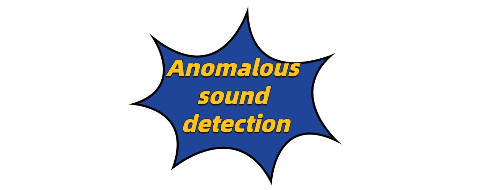

<a name="readme-top"></a>

<div align="center">
  <h1>🌟 Awesome Anomalous Sound Detection (ASD) 🌟</h1>
  <p><em>A comprehensive and meticulously curated list of resources, datasets, and cutting-edge papers for Anomalous Sound Detection.</em></p>
</div>

<br>

[](https://github.com/sindresorhus/awesome)
[](https://GitHub.com/Naereen/StrapDown.js/graphs/commit-activity)
[](http://makeapullrequest.com) 
[](https://arxiv.org/abs/2403.04279) 
[](https://visitor-badge.laobi.icu/badge?page_id=Chengyuann.Awesome-Anomalous-Sound-Detection-Methods)

<div align="center">
  
</div>

---

## 🔖 News!!!

> **🚀 Stay tuned!** We are continuously updating this repository with the latest breakthroughs in audio anomaly detection.

📌 We are actively tracking the latest research and welcome contributions to our repository and survey paper. If your studies are relevant, please feel free to contact us.

📌 **2026-09-23:** Added verified 2025–2026 papers. Conference and journal papers are grouped by publication venue; preprints and accepted-but-not-yet-published papers are explicitly marked.

---

## 🎁 How to contribute to this repository?
Since the following content is generated based on our database, please provide the following information in the **issue** to help us fill in the database to add new papers (please do not submit a PR directly).
```text
1. Paper title
2. arXiv ID (if any)
3. Publication status (if any)
```

## Review and Count

|  Pub | Year      |Datasets                                                 | Note       |
| :--: | --------- | ------------------------------------------------------------ |---------- |
| ICASSP | 2020-2026   | DCASE2020 /DCASE2022        |           |
| ICANN | 2025   | DCASE2024        |           |
| TSALP | 2023、2025-2026 |DCSASE |          |
| SPL | 2025 |DCSASE |          |
| Applied Acoustics | 2023、2025  | DCASE |        |
| ArXiv   | 2025-2026     | DCASE / MIMII | Preprints |
| DCASE | 2020-2026 | DCASE | 2026 accepted paper explicitly marked |
| EUSIPCO| 2018、2021、2025 | Sound Ideas Series 6000 General Sound Effects Library 、DCASE |            |
|ICCE| 2020 | MIMII  |            |
|Digital Signal Processing| 2023、2025-2026 | DCASE |            |
| Interspeech | 2025-2026 | DCASE | |
| ICONIP | 2025 | DCASE | |
| APSIPA Transactions on Signal and Information Processing | 2025 | DCASE | |
| APSIPA ASC | 2025 | DCASE | |
| Signal Processing | 2026 | | |


<details>
  <summary>🗂️ Table of Contents</summary>
  <ol>
    <li><a href="#papers">📝 Papers</a>
      <ul>
        <li><a href="#diffusion-models">Dual Models</a></li>
        <li><a href="#consistency-models">Generative Models</a></li>
      </ul>
    </li>
    <li><a href="#other-resources">🔗 Other Resources</a></li>
    <li><a href="#contributing">✍️ Contributing</a></li>
  </ol>
</details>

# 🗂️ dataset 

## DCASE20

Download the dataset from **[Audio dataset.](https://dcase.community/challenge2020/task-unsupervised-detection-of-anomalous-sounds)**

 
# 📝 Papers

## ICASSP

### Dual Models


 
1. **[SW-WAVENET: Learning Representation from Spectrogram and Wavegram Using Wavenet for Anomalous Sound Detection.](https://ieeexplore.ieee.org/document/10096742)**

    


    *H. Chen, L. Ran, X. Sun and C. Cai.* ICASSP'24. 🔥
  


1. **[NOISY-ARCMIX: ADDITIVE NOISY ANGULAR MARGIN LOSS COMBINED WITH MIXUP FOR ANOMALOUS SOUND DETECTION.](https://arxiv.org/pdf/2310.06364)** **[CODE.](https://github.com/soonhyeon/Noisy-ArcMix)**

    


   *Soonhyeon Choi, Jung-Woo Choi.* ICASSP'24. 🔥


1. **[A DUAL-PATH FRAMEWORK WITH FREQUENCY-AND-TIME EXCITED NETWORK FOR ANOMALOUS SOUND DETECTION.](https://ieeexplore.ieee.org/document/10448126)**

    


    *Yucong Zhang, Juan Liu, Yao Tian, Haifeng Liu, Ming Li.* ICASSP'24. 🔥

1. **[Hierarchical Metadata Information Constrained Self-Supervised Learning for Anomalous Sound Detection under Domain Shift.](https://ieeexplore.ieee.org/document/10446044)**

    


    *H. Lan, Q. Zhu, J. Guan, Y. Wei and W. Wang.* ICASSP'24. 🔥


1. **[DP-MAE: A Dual-Path Masked Autoencoder Based Self-Supervised Learning Method for Anomalous Sound Detection.](https://ieeexplore.ieee.org/document/10447859)**

    


    *Z. -L. Liu, Y. Song, X. -M. Zeng, L. -R. Dai and I. McLoughlin.* ICASSP'24. 🔥
   

1. **[Anomalous Sound Detection Using Audio Representation with Machine ID Based Contrastive Learning Pretraining.](https://arxiv.org/pdf/2304.03588v1)**

    


    *J. Guan, F. Xiao, Y. Liu, Q. Zhu and W. Wang.* ICASSP'23. 🔥


1. **[Anomalous Sound Detection Using Spectral-Temporal Information Fusion.](https://ieeexplore.ieee.org/document/9747868)**
*[code](https://github.com/liuyoude/STgram_MFN)*

    


    *Youde Liu; Jian Guan; Qiaoxi Zhu; Wenwu Wang.* ICASSP'22. 🔥
   
## Generative Models

1. **[TLDiffGAN: A Latent Diffusion-GAN Framework with Temporal Information Fusion for Anomalous Sound Detection.](https://arxiv.org/abs/2602.01060)**

    *Chengyuan Ma, Peng Jia, Hongyue Guo and Wenming Yang.* ICASSP'26. 🔥

1. **[RefGen: Reference-Guided Synthetic Data Generation for Anomalous Sound Detection.](https://doi.org/10.1109/ICASSP55912.2026.11461896)**

    *Wenrui Liang, Yihong Qiu, Anbai Jiang, Bing Han, Tianyu Liu, Xinhu Zheng, Pingyi Fan, Cheng Lu, Jia Liu and Wei-Qiang Zhang.* ICASSP'26. 🔥

1. **[Diffusion Augmentation Sub-center Modeling for Unsupervised Anomalous Sound Detection with Partially Attribute-Unavailable Conditions.](https://doi.org/10.1109/ICASSP49660.2025.10890695)**

    *Jiawei Yin, Yu Gao, Wenbin Zhang, Tianyi Wang and Mingjun Zhang.* ICASSP'25. 🔥

1. **[UNSUPERVISED ANOMALY DETECTION AND LOCALIZATION OF MACHINE AUDIO: A GAN-BASED APPROACH.](https://arxiv.org/pdf/2303.17949)**
2. **[\[CODE\]](https://github.com/jianganbai/AEGAN-AD)**

    


    *A. Jiang, W. -Q. Zhang, Y. Deng, P. Fan and J. Liu.* ICASSP'23. 🔥


## GMM Models


1. **[Time-Weighted Frequency Domain Audio Representation with GMM Estimator for Anomalous Sound Detection.](https://ieeexplore.ieee.org/document/10096356)**

    


    *A. Jiang, W. -Q. Zhang, Y. Deng, P. Fan and J. Liu.* ICASSP'23. 🔥


### Other Models

1. **[Improving Anomalous Sound Detection with Attribute-Aware Representation from Domain-Adaptive Pre-Training.](https://arxiv.org/abs/2509.12845)**

    *Xin Fang, Guirui Zhong, Qing Wang, Fan Chu, Lei Wang, Mengui Qian, Mingqi Cai, Jiangzhao Wu, Jianqing Gao and Jun Du.* ICASSP'26. 🔥

1. **[RASD-SR: A Robust Anomalous Sound Detection Framework with Score Recalibration.](https://doi.org/10.1109/ICASSP55912.2026.11461278)**

    *Ting Wu, Lu Han, Zhaoli Yan, Xiaobin Cheng and Jun Yang.* ICASSP'26. 🔥

1. **[Toward Faithful Explanations in Acoustic Anomaly Detection.](https://arxiv.org/abs/2601.12660)** **[CODE.](https://github.com/Maab-Nimir/Faithful-Explanations-in-Acoustic-Anomaly-Detection)**

    *Maab Elrashid, Anthony Deschênes, Cem Subakan, Mirco Ravanelli, Rémi Georges and Michael Morin.* ICASSP'26. 🔥

1. **[Timbre-Aware Audio Difference Captioning for Anomalous Machine Sounds without Paired Training Data via Synthetic Perturbations.](https://doi.org/10.1109/ICASSP55912.2026.11463819)**

    *Tomoya Nishida, Harsh Purohit, Kota Dohi, Takashi Endo and Yohei Kawaguchi.* ICASSP'26. 🔥

1. **[Disentangling Hierarchical Features for Anomalous Sound Detection Under Domain Shift.](https://arxiv.org/abs/2501.01604)**

    *Jian Guan, Jiantong Tian, Qiaoxi Zhu, Feiyang Xiao, Hejing Zhang and Xubo Liu.* ICASSP'25. 🔥

1. **[Deep Generic Representations for Domain-Generalized Anomalous Sound Detection.](https://arxiv.org/abs/2409.05035)**

    *Phurich Saengthong and Takahiro Shinozaki.* ICASSP'25. 🔥

1. **[Adaptive Prototype Learning for Anomalous Sound Detection with Partially Known Attributes.](https://doi.org/10.1109/ICASSP49660.2025.10889514)**

    *Anbai Jiang, Xinhu Zheng, Bing Han, Yihong Qiu, Pingyi Fan, Wei-Qiang Zhang, Cheng Lu and Jia Liu.* ICASSP'25. 🔥

1. **[Keeping the Balance: Anomaly Score Calculation for Domain Generalization.](https://doi.org/10.1109/ICASSP49660.2025.10888402)**

    *Kevin Wilkinghoff, Haici Yang, Janek Ebbers, François G. Germain, Gordon Wichern and Jonathan Le Roux.* ICASSP'25. 🔥

1. **[Improvements of Discriminative Feature Space Training for Anomalous Sound Detection in Unlabeled Conditions.](https://ieeexplore.ieee.org/document/10890020)**


    *Takuya Fujimura et al.* ICASSP'25. 🔥

1. **[An Effective Anomalous Sound Detection Method Based on Representation Learning with Simulated Anomalies.](https://ieeexplore.ieee.org/document/10095398)**

    


    *H. Chen et al.* ICASSP'23. 🔥

1. **[Self-Supervised Representation Learning for Unsupervised Anomalous Sound Detection Under Domain Shift.](https://ieeexplore.ieee.org/document/9747863)**

    

    


    *H. Chen, Y. Song, L. -R. Dai, I. McLoughlin and L. Liu.* ICASSP'23. 🔥

1. **[Noise Supervised Contrastive Learning and Feature-Perturbed for Anomalous Sound Detection.](https://arxiv.org/abs/2509.13853)**


    


    *S. Huang, Z. Fang, L. and L. He.* ICASSP'25. 🔥

1. **[An Enhanced Audio Feature Tailored for Anomalous Sound Detection Based on Pre-trained Models.](https://arxiv.org/abs/2508.15334)**

      *Guirui Zhong, Qing Wang. and Xin Fang.* ICASSP'25. 🔥
   
## SPL

1. **[An Anomalous Sound Detection Network Based on Time-Frequency Attention and Improved One-Class Softmax.](https://doi.org/10.1109/LSP.2025.3624129)**

    *Sihan Wang, Shuhao Zhang, Bo Cheng and Shuwei Sheng.* SPL'25. 🔥

1. **[ESTM: An Enhanced Dual-Branch Spectral-Temporal Mamba for Anomalous Sound Detection](https://ieeexplore.ieee.org/abstract/document/10329432)**

    

*C. Ma, P. Jia  and W. Yang.* SPL'25. 🔥

## TASLP

1. **[Self-Supervised Learning With Attention-Guided Statistics Exchange for Anomalous Sound Detection.](https://doi.org/10.1109/TASLPRO.2026.3714225)**

    *Dong Wang, Jiqing Han, Tieran Zheng, Guibin Zheng, Yongjun He and Liwen Zhang.* IEEE Transactions on Audio, Speech and Language Processing 2026. 🔥

1. **[Angular Margin Loss-Driven and Distance-Aware Multi-Sample Mixing for Self-Supervised Anomalous Sound Detection.](https://doi.org/10.1109/TASLPRO.2026.3657205)**

    *Dong Wang, Jiqing Han, Guibin Zheng, Tieran Zheng, Yongjun He and Liwen Zhang.* IEEE Transactions on Audio, Speech and Language Processing 2026. 🔥

1. **[Local Density-Based Anomaly Score Normalization for Domain Generalization.](https://arxiv.org/abs/2509.10951)** **[CODE.](https://github.com/merlresearch/anomaly-score-normalization)**

    *Kevin Wilkinghoff, Haici Yang, Janek Ebbers, François G. Germain, Gordon Wichern and Jonathan Le Roux.* IEEE Transactions on Audio, Speech and Language Processing 2025. 🔥

1. **[Exploring Self-Supervised Audio Models for Generalized Anomalous Sound Detection.](https://arxiv.org/abs/2508.12230)**

    *Bing Han, Anbai Jiang, Xinhu Zheng, Wei-Qiang Zhang, Jia Liu, Pingyi Fan and Yanmin Qian.* IEEE Transactions on Audio, Speech and Language Processing 2025. 🔥

1. **[Machine Anomalous Sound Detection Using Spectral-Temporal Modulation Representations Derived From Machine-Specific Filterbanks.](https://doi.org/10.1109/TASLPRO.2025.3570956)**

    *Kai Li, Khalid Zaman, Xingfeng Li, Masato Akagi, Jianwu Dang and Masashi Unoki.* IEEE Transactions on Audio, Speech and Language Processing 2025. 🔥

1. **[Why Do Angular Margin Losses Work Well for Semi-Supervised Anomalous Sound Detection?](https://ieeexplore.ieee.org/document/11152580)**

    


    *HK. Wilkinghoff and F. Kurth.* IEEE/ACM Transactions on Audio, Speech, and Language Processing 2023. 🔥

1. **[Why Do Angular Margin Losses Work Well for Semi-Supervised Anomalous Sound Detection?](https://ieeexplore.ieee.org/abstract/document/10329432)**

    


    *HK. Wilkinghoff and F. Kurth.* IEEE/ACM Transactions on Audio, Speech, and Language Processing 2023. 🔥


1. **[AdaProj: Adaptively Scaled Angular Margin Subspace Projections for Anomalous Sound Detection with Auxiliary Classification Tasks](https://arxiv.org/abs/2403.14179)**

    


    *Kevin Wilkinghoff.* DCASE 2024. 🔥


## Applied Acoustics
 
1. **[SDMAE: A self-supervised learning method based on a self-distillation masked autoencoder for anomalous sound detection.](https://doi.org/10.1016/j.apacoust.2025.110828)**

    *Shengheng Ye and Junhe Yu.* Applied Acoustics 2025. 🔥

1. **[A lightweight framework for unsupervised anomalous sound detection based on selective learning of time-frequency domain features.](https://doi.org/10.1016/j.apacoust.2024.110308)**

    *Yawei Wang, Qiaoling Zhang, Weiwei Zhang and Yi Zhang.* Applied Acoustics 2025. 🔥

   1. **[Unsupervised anomalous sound detection for industrial monitoring based on ArcFace classifier and gaussian mixture model](https://www.sciencedirect.com/science/article/pii/S0003682X2200562X)**


  *Ji Wu ,Fei Yang .* Applied Acoustics Volume 203, 28 February 2023, 109188. 🔥


## Interspeech

1. **[UD-ASD: A Unified Diffusion Model for Anomalous Sound Detection.](https://www.isca-archive.org/interspeech_2026/gao26c_interspeech.html)**

    *Pengxiang Gao, Yu Qiu and Yanzhi Song.* Interspeech'26. 🔥

1. **[Mind the Gap: Detecting Cluster Exits for Robust Local Density-Based Score Normalization in Anomalous Sound Detection.](https://www.isca-archive.org/interspeech_2026/wilkinghoff26_interspeech.html)**

    *Kevin Wilkinghoff, Gordon Wichern, Jonathan Le Roux and Zheng-Hua Tan.* Interspeech'26. 🔥

1. **[Towards Few-Shot Training-Free Anomaly Sound Detection.](https://www.isca-archive.org/interspeech_2025/wu25b_interspeech.html)**

    *Ho-Hsiang Wu, Wei-Cheng Lin, Abinaya Kumar, Luca Bondi, Shabnam Ghaffarzadegan and Juan Pablo Bello.* Interspeech'25. 🔥

1. **[Dual Orthogonality Sub-center Loss for Enhanced Anomalous Sound Detection.](https://www.isca-archive.org/interspeech_2025/wang25n_interspeech.html)**

    *Dong Wang, Jiqing Han, Tieran Zheng, Guibin Zheng and Yongjun He.* Interspeech'25. 🔥

1. **[Adaptive Across-Subcenter Representation Learning for Imbalanced Anomalous Sound Detection.](https://www.isca-archive.org/interspeech_2025/wang25p_interspeech.html)**

    *Dong Wang, Jiqing Han, Guibin Zheng, Tieran Zheng and Yongjun He.* Interspeech'25. 🔥

1. **[Finetune Large Pre-Trained Model Based on Frequency-Wise Multi-Query Attention Pooling for Anomalous Sound Detection.](https://www.isca-archive.org/interspeech_2025/jiang25c_interspeech.html)**

    *Nan Jiang, Yan Song, Qing Gu, Haoyu Song, Lirong Dai and Ian McLoughlin.* Interspeech'25. 🔥

1. **[An Effective Anomalous Sound Detection Method Based on Global and Local Attribute Mining.](https://www.isca-archive.org/interspeech_2025/jiang25b_interspeech.html)**

    *Nan Jiang, Yan Song, Qing Gu, Haoyu Song, Lirong Dai and Ian McLoughlin.* Interspeech'25. 🔥

1. **[Anomalous Sound Detection Based Feature Fusion and Dual-path Non-linear Independent Components Estimation.](https://www.isca-archive.org/interspeech_2025/wang25r_interspeech.html)**

    *Yawei Wang, Qiaoling Zhang, Yi Zhang and Junyao Hu.* Interspeech'25. 🔥

## DCASE

1. **[Anomalous Sound Detection Meets Noise-Aware Self-Supervised Learning.](https://arxiv.org/abs/2608.00447)**

    *Takuya Fujimura, Gordon Wichern, Yoshiki Masuyama, Christoph Boeddeker, Kohei Saijo, Julius Richter, Takahiro Edo and Jonathan Le Roux.* DCASE'26 (accepted; author-reported on arXiv). 🔥

1. **[ASDKit: A Toolkit for Comprehensive Evaluation of Anomalous Sound Detection Methods.](https://arxiv.org/abs/2507.10264)**

    *Takuya Fujimura, Kevin Wilkinghoff, Keisuke Imoto and Tomoki Toda.* DCASE'25. 🔥

1. **[Discriminative Anomalous Sound Detection Using Pseudo Labels, Target Signal Enhancement, and Ensemble Feature Extractors.](https://dcase.community/documents/workshop2025/proceedings/DCASE2025Workshop_Fujimura_60.pdf)**

    *Takuya Fujimura, Ibuki Kuroyanagi and Tomoki Toda.* DCASE'25. 🔥

1. **[Adjusting Bias in Anomaly Scores via Variance Minimization for Domain-Generalized Discriminative Anomalous Sound Detection.](https://dcase.community/documents/workshop2025/proceedings/DCASE2025Workshop_Matsumoto_12.pdf)**

    *Masaaki Matsumoto, Takuya Fujimura, WenChin Huang and Tomoki Toda.* DCASE'25. 🔥

1. **[Correlation-Based Filtering for Unsupervised Anomalous Sound Detection.](https://dcase.community/documents/workshop2025/proceedings/DCASE2025Workshop_Burli_4.pdf)**

    *Andrin Bürli and Sami Hamdan.* DCASE'25. 🔥

1. **[Efficient State-Space Model for Audio Anomaly Detection with Domain Adaptation.](https://dcase.community/documents/workshop2025/proceedings/DCASE2025Workshop_Emon_2.pdf)**

    *Jakaria Emon and Taharim Rahman Anon.* DCASE'25. 🔥

1. **[MIMII-Agent: Leveraging LLMs with Function Calling for Relative Evaluation of Anomalous Sound Detection.](https://arxiv.org/abs/2507.20666)**

    *Harsh Purohit, Tomoya Nishida, Kota Dohi, Takashi Endo and Yohei Kawaguchi.* DCASE'25. 🔥

1. **[Handling Domain Shifts for Anomalous Sound Detection: A Review of DCASE-Related Work.](https://arxiv.org/abs/2503.10435)**

    *Kevin Wilkinghoff, Takuya Fujimura, Keisuke Imoto, Jonathan Le Roux, Zheng-Hua Tan and Tomoki Toda.* DCASE'25. 🔥

1. **[Description and Discussion on DCASE 2025 Challenge Task 2: First-Shot Unsupervised Anomalous Sound Detection for Machine Condition Monitoring.](https://arxiv.org/abs/2506.10097)**

    *Tomoya Nishida, Noboru Harada, Daisuke Niizumi, Davide Albertini, Roberto Sannino, Simone Pradolini, Filippo Augusti, Keisuke Imoto, Kota Dohi, Harsh Purohit, Takashi Endo and Yohei Kawaguchi.* DCASE'25. 🔥

1. **[ToyADMOS2025: The Evaluation Dataset for the DCASE2025T2 First-Shot Unsupervised Anomalous Sound Detection for Machine Condition Monitoring.](https://dcase.community/documents/workshop2025/proceedings/DCASE2025Workshop_Harada_78.pdf)**

    *Noboru Harada, Daisuke Niizumi, Yasunori Ohishi, Daiki Takeuchi and Masahiro Yasuda.* DCASE'25. 🔥

1. **[LiB-TRAD: A Lithium Battery Thermal Runaway Acoustic Dataset for Anomaly Detection.](https://dcase.community/documents/workshop2025/proceedings/DCASE2025Workshop_WANG_17.pdf)**

    *Xiaoliang Wang, Ao Ming, Meixin Chen and Hao Jin.* DCASE'25. 🔥

## EUSIPCO

1. **[MIMII-Gen: Generative Modeling Approach for Simulated Evaluation of Anomalous Sound Detection System.](https://arxiv.org/abs/2409.18542)**

    *Harsh Purohit, Tomoya Nishida, Kota Dohi, Takashi Endo and Yohei Kawaguchi.* EUSIPCO'25. 🔥

1. **[Unsupervised Anomalous Sound Detection Focused on Timbral-Related Features.](https://doi.org/10.23919/EUSIPCO63237.2025.11226702)**

    *Ryoya Ogura and Masashi Unoki.* EUSIPCO'25. 🔥

## ICONIP

1. **[Multi-scale Scanning Network for Machine Anomalous Sound Detection.](https://arxiv.org/abs/2508.17194)**

    *Yucong Zhang, Juan Liu and Ming Li.* ICONIP'25. 🔥

## APSIPA Transactions on Signal and Information Processing

1. **[Serial-OE: Anomalous Sound Detection Based on Serial Method with Outlier Exposure Capable of Using Small Amounts of Anomalous Data for Training.](https://arxiv.org/abs/2505.18982)**

    *Ibuki Kuroyanagi, Tomoki Hayashi, Kazuya Takeda and Tomoki Toda.* APSIPA Transactions on Signal and Information Processing 2025. 🔥

1. **[Improving Anomalous Sound Detection Through Pseudo-anomalous Set Selection and Pseudo-label Utilization Under Unlabeled Conditions.](https://arxiv.org/abs/2505.18980)**

    *Ibuki Kuroyanagi, Takuya Fujimura, Kazuya Takeda and Tomoki Toda.* APSIPA Transactions on Signal and Information Processing 2025. 🔥

## APSIPA ASC

1. **[Retrieval-Augmented Difference Captioning to Explain Unsupervised Anomalous Sound Detection.](https://doi.org/10.1109/APSIPAASC65261.2025.11249188)**

    *Ryoya Ogura, Tomoya Nishida and Yohei Kawaguchi.* APSIPA ASC'25. 🔥

## Digital Signal Processing

1. **[MSANet: Multi-Stage attention network for anomalous sound detection in machine condition monitoring.](https://doi.org/10.1016/j.dsp.2025.105626)**

    *Hao Zhou, Yi Zhou, Yin Liu and Hongqing Liu.* Digital Signal Processing 2026. 🔥

1. **[An unsupervised anomalous sound detection method based on similarity-driven automatic feature selection.](https://doi.org/10.1016/j.dsp.2025.105123)**

    *Yi Zhang, Jie Feng, Qiaoling Zhang, Junyao Hu and Weiwei Zhang.* Digital Signal Processing 2025. 🔥

## Signal Processing

1. **[LAES: A local adaptive edge-enhanced spectrogram method for unsupervised anomalous sound detection.](https://doi.org/10.1016/j.sigpro.2026.110584)**

    *Jiyu Lu, Wenbo Guan, Ming Zhang, Ta Li and Yonghong Yan.* Signal Processing 2026. 🔥

1. **[STWWgram-ODCBAM: Multimodal feature fusion and dynamic attention mechanism for anomalous sound detection.](https://doi.org/10.1016/j.sigpro.2025.110218)**

    *Libin Zheng, Dongsheng Liu, Tong Wu and Yahui Chen.* Signal Processing 2026. 🔥

## ArXiv

### 2026

1. **[MemNMF: Memory-Augmented NMF on LPC Spectra for Anomalous Sound Detection.](https://arxiv.org/abs/2607.22086)**

    *Phurich Saengthong and Takahiro Shinozaki.* arXiv 2026 (preprint). 🔥

1. **[Pseudo-label distillation for discriminative anomalous sound detection.](https://arxiv.org/abs/2607.16678)**

    *Takuya Fujimura and Tomoki Toda.* arXiv 2026 (preprint). 🔥

1. **[ECHOv2: A Frequency-Structured Pre-trained Acoustic Representation Model with Cross-Band Modeling for Machine Anomalous Sound Detection.](https://arxiv.org/abs/2607.10596)** **[CODE.](https://github.com/yucongzh/ECHO)**

    *Yucong Zhang, Juan Liu and Ming Li.* arXiv 2026 (preprint). 🔥

1. **[Training-Free Model Selection and Domain-Aware Score Calibration for First-Shot Anomalous Sound Detection.](https://arxiv.org/abs/2607.04526)**

    *Grach Mkrtchian.* arXiv 2026 (preprint). 🔥

1. **[Scoring Backends Matter More Than Pooling: A Systematic Study of Training-Free Anomalous Sound Detection under Domain Shift.](https://arxiv.org/abs/2606.19269)**

    *Jingwen Zhou and Mingzhe Wang.* arXiv 2026 (preprint). 🔥

1. **[Description and Discussion on DCASE 2026 Challenge Task 2: Noise-aware Unsupervised Anomalous Sound Detection for Machine Condition Monitoring.](https://arxiv.org/abs/2606.01578)**

    *Tomoya Nishida, Noboru Harada, Daiki Takeuchi, Daisuke Niizumi, Keisuke Imoto, Kota Dohi, Harsh Purohit, Takashi Endo and Yohei Kawaguchi.* arXiv 2026 (challenge description preprint). 🔥

1. **[Sub-Band Spectral Matching with Localized Score Aggregation for Robust Anomalous Sound Detection.](https://arxiv.org/abs/2603.13749)**

    *Phurich Saengthong and Takahiro Shinozaki.* arXiv 2026 (preprint; under review). 🔥

1. **[Temporal Pooling Strategies for Training-Free Anomalous Sound Detection with Self-Supervised Audio Embeddings.](https://arxiv.org/abs/2603.04605)**

    *Kevin Wilkinghoff, Sarthak Yadav and Zheng-Hua Tan.* arXiv 2026 (preprint). 🔥

1. **[How Much Does Machine Identity Matter in Anomalous Sound Detection at Test Time?](https://arxiv.org/abs/2602.16253)**

    *Kevin Wilkinghoff, Keisuke Imoto and Zheng-Hua Tan.* arXiv 2026 (preprint). 🔥

1. **[A Framework for Evaluating Faithfulness in Explainable AI for Machine Anomalous Sound Detection Using Frequency-Band Perturbation.](https://arxiv.org/abs/2601.19017)**

    *Alexander Buck, Georgina Cosma, Iain Phillips, Paul Conway and Patrick Baker.* arXiv 2026 (preprint). 🔥

1. **[Quantitative Analysis of Proxy Tasks for Anomalous Sound Detection.](https://arxiv.org/abs/2601.08480)** **[CODE.](https://github.com/shin3875/asd-proxy-task-analysis)**

    *Seunghyeon Shin and Seokjin Lee.* arXiv 2026 (preprint; submitted to Expert Systems with Applications). 🔥

### 2025

1. **[Retaining Mixture Representations for Domain Generalized Anomalous Sound Detection.](https://arxiv.org/abs/2510.25182)**

    *Phurich Saengthong, Tomoya Nishida, Kota Dohi, Natsuo Yamashita and Yohei Kawaguchi.* arXiv 2025 (preprint; submitted to ICASSP 2026, acceptance not verified). 🔥

1. **[Explainable anomaly detection for sound spectrograms using pooling statistics with quantile differences.](https://arxiv.org/abs/2506.21921)**

    *Nicolas Thewes, Philipp Steinhauer, Patrick Trampert, Markus Pauly and Georg Schneider.* arXiv 2025 (preprint). 🔥

1. **[From Vision to Sound: Advancing Audio Anomaly Detection with Vision-Based Algorithms.](https://arxiv.org/abs/2502.18328)**

    *Manuel Barusco, Francesco Borsatti, Davide Dalle Pezze, Francesco Paissan, Elisabetta Farella and Gian Antonio Susto.* arXiv 2025 (preprint). 🔥

<p align="right" style="font-size: 14px; color: #555; margin-top: 20px;">
    <a href="#readme-top" style="text-decoration: none; color: #007bff; font-weight: bold;">
        ↑ Back to Top ↑
    </a>
</p>
